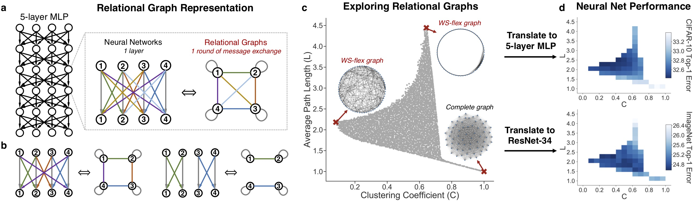

# graph2nn for Apple Silicon

An unofficial port of **[facebookresearch/graph2nn](https://github.com/facebookresearch/graph2nn)**, the code for
*[Graph Structure of Neural Networks](https://arxiv.org/abs/2007.06559)* (J. You, J. Leskovec, K. He, S. Xie, ICML 2020),
to **Apple Silicon Macs (any M-series chip, PyTorch MPS backend)** and current Python / PyTorch, with tools for running and
checking the experiments on a single machine.

Mainly built by Claude Opus 5.5 (Anthropic), guided by Sang Hoon Lee (Gyeongsang National University).

CUDA / Linux machines keep working: the device is chosen automatically (CUDA, then MPS, then CPU).

> Not affiliated with Meta / Facebook AI Research. The original authors' README is kept unchanged in
> [`docs/ORIGINAL_README.md`](docs/ORIGINAL_README.md).

<div align="center">
  
  <p><i>Relational graphs of neural networks (figure from the original repository).</i></p>
</div>

## Reproduction on an M4 Max

5-layer 512-d MLP on CIFAR-10, 200 epochs, run on a MacBook Pro (M4 Max, 16-core CPU, 40-core GPU, 128 GB), compared
with the original authors' raw per-seed results shipped in [`analysis/final_results/`](analysis/final_results) (CUDA).

| Top-1 error (%), 5 seeds | This port (MPS) | Original (CUDA) |
|---|---|---|
| Baseline (complete graph) | 33.45 ± 0.24 | 33.34 ± 0.36 |
| Best relational graph | 32.30 ± 0.26 | 32.05 ± 0.14 |

Graph by graph (all 52 graphs of the paper's cross-task comparison set, 3–5 seeds each):

| | This port vs. original |
|---|---|
| Per-graph Pearson correlation | **r = 0.78** (p = 8e-12); Spearman 0.68 |
| Agreement among the paper's own runs (3 vs 2 seeds) | r ≈ 0.59 (10th–90th percentile 0.51–0.66) |
| Mean / RMS difference per graph | +0.01 / 0.21 points |
| Gain of the best graph over the baseline | +1.15 points (original: +1.29) |
| Graphs better than the baseline | 50/52 (original: 50/52) |
| Top-8 graphs in common | 1/8 (the paper's own seeds share ~2/8; 10th–90th percentile 1–3) |
| Sweet spot (mean C, L of the top 8) | C = 0.50, L = 2.19 (original: C = 0.47, L = 2.37; seed noise alone: \|ΔC\| < 0.10, \|ΔL\| < 0.23) |

The port reproduces the paper's MLP results within seed noise: the per-graph errors, the gain over the complete
graph, and the location of the sweet spot in clustering and path length. Which graphs make the top 8 is not
reproducible even among the paper's own seeds, because the best graphs differ by less than the seed-to-seed
spread (about 0.3 points). Reproduce this table with `tools/paper_compare.py` (see [below](#compare-with-the-paper)).
The 52-graph runs were made on macOS before and after a system update (October 2026).

### Biological networks

The paper's cortical connectomes as relational graphs (5-layer MLP, CIFAR-10, 5 seeds; mean ± std; in parentheses:
difference to the complete graph). Nodes are cortical areas, not neurons:

| Graph | Original (paper, Table 2) | This port, M4 Max (MPS) | This port, RTX 3080 (CUDA) |
|---|---|---|---|
| Complete graph | 33.34 ± 0.36 | 33.39 ± 0.24 | 33.29 ± 0.20 |
| Cat cortex (52 areas) | 33.01 ± 0.22 (−0.33) | 32.88 ± 0.40 (−0.51) | 32.67 ± 0.44 (−0.62) |
| Macaque visual cortex (30) | 32.78 ± 0.21 (−0.56) | 32.87 ± 0.48 (−0.52) | 32.67 ± 0.52 (−0.62) |
| Macaque whole cortex (71) | 32.77 ± 0.14 (−0.57) | 32.87 ± 0.31 (−0.52) | 32.77 ± 0.30 (−0.52) |

All three biological graphs beat the complete graph by about half a point on both platforms, as in the paper; MPS
and CUDA agree within seed noise (0.1–0.2 points, p > 0.4 for each graph).

```bash
bash launch_parallel.sh mlp_cifar10_bio best 1 3 0
python tools/bio_compare.py                      # or --dirs best best_cuda to compare two machines
```

### What has been verified

| Part of the paper | Status |
|---|---|
| Model construction, all experiments: relational graphs, masked layers, FLOPs matching | **verified**: all 315 models of the six model families (baseline, best graph and the 52 or 48 comparison graphs each) have the paper's parameter counts and FLOPs (`tools/check_paper_models.py --all`) |
| MLP / CIFAR-10: baseline and best graph | **reproduced** within seed noise (table above) |
| MLP / CIFAR-10: graph by graph and the sweet spot in clustering and path length | **reproduced on all 52** comparison graphs (table above) |
| MLP / CIFAR-10: the full sweep over 3,942 graphs | not rerun (the 52-graph set is the paper's own summary of it) |
| MLP / CIFAR-10: biological networks (cat, macaque visual and whole cortex) | **reproduced** on the Mac and on CUDA (table above; `tools/bio_compare.py`) |
| MLP / CIFAR-10: few-epoch runs predicting the final ranking | not tested |
| ImageNet: 8-layer CNN, ResNet-34, ResNet-34-sep, ResNet-50, EfficientNet-B0 | **not reproduced**: data installation and training on MPS and CUDA checked (`tools/check_imagenet.py`, `tools/check_gpu.py`); full runs need GPU time (see [Reproduction tests](#reproduction-tests)) |
| Cross-task consistency (the same graphs good on CIFAR-10 and ImageNet) | needs the ImageNet runs |

## What's different from the original

**Apple Silicon / modern PyTorch**
- New config option `DEVICE` (`auto` | `cuda` | `mps` | `cpu`); every hard-coded `.cuda()` replaced.
- Relational-graph masks are registered buffers, so they move with the model to any device; checkpoints stay
  compatible with the original code.
- Multi-GPU configs (`NUM_GPUS 8`) run as one process with the same total batch size on MPS / CPU.
- Pinned memory and cuDNN settings only on CUDA; persistent data-loader workers (macOS starts workers with
  `spawn`); checkpoints load with `map_location='cpu'`, so CUDA-trained checkpoints open on a Mac.
- Updated for networkx 3, PyYAML 6 and PyTorch 2; TensorFlow is no longer needed (tensorboardX is optional).

**Bug fixes** (all also present in the original code)
- CIFAR-10 images were normalized in place in the stored dataset, so they were re-normalized every time they were
  read. On Linux this was masked because data-loader workers were re-created each epoch; with persistent workers,
  or with `NUM_WORKERS 0`, test accuracy collapsed to chance.
- ImageNet classes were numbered in file-system order (not sorted), so train and val labels could disagree, and
  macOS `.DS_Store` files broke loading.
- The biological graphs (`mcwhole`, `cat`, …) only loaded when run from inside `pycls/datasets/`.
- `launch.sh` ignored its GPU argument when choosing 1-GPU or 8-GPU ImageNet configs.
- CNN configs chose their FLOPs-matching target from the output-folder name and crashed for other names.
- `RGRAPH.KEEP_GRAPH False` (a different relational graph in every layer, never used in the paper) ignored the graph
  seed and derived the layers' graphs from the layer width; each layer's graph now derives from `SEED_GRAPH` and the
  layer index (MLP).

**New tools**

| | |
|---|---|
| `launch_parallel.sh` | Run many configs / seeds at once on one machine; resumable; Ctrl-C stops everything |
| `tools/paper_compare.py` | Compare your results with the paper's raw results, graph by graph |
| `tools/prepare_imagenet.py` | Build the ImageNet folder layout from the Kaggle or image-net.org downloads; make subsets |
| `tools/check_imagenet.py` | Verify an ImageNet installation (counts, decoding, labels, loader speed, GPU training) |
| `tools/check_mps.py` | Quick CPU-vs-MPS training check |
| `tools/bio_compare.py` | Biological relational graphs vs. the paper's Table 2, across machines, with time per epoch |
| `tools/check_paper_models.py`, `tools/check_gpu.py` | Models match the paper (parameters, FLOPs); hardware check (see [Reproduction tests](#reproduction-tests)) |
| `tools/progress.py` | Progress and estimated finish time of a `launch_parallel.sh` run |

## Installation (macOS, Apple Silicon)

Use a native arm64 Python (e.g. [Miniforge](https://github.com/conda-forge/miniforge)), not an x86 environment
running under Rosetta.

```bash
git clone https://github.com/lshlj82/graph2nn-apple-silicon.git
cd graph2nn-apple-silicon
conda create -n graph2nn python=3.11 && conda activate graph2nn
pip install torch torchvision
pip install -r requirements.txt
pip install -e .
python tools/check_mps.py
```

`check_mps.py` trains a few steps on the CPU and on the GPU from the same starting point; the losses should match.
On Linux with CUDA, install the CUDA build of PyTorch instead; everything else is the same.

## Data

Datasets are expected under `pycls/datasets/data/` (symbolic links are fine). On a Mac, keep them in a folder whose
name ends in `.noindex` (skipped by Spotlight) and exclude it from Time Machine.

**CIFAR-10** (~170 MB)
```bash
mkdir -p ~/datasets.noindex && cd ~/datasets.noindex
curl -L -o cifar-10-python.tar.gz https://www.cs.toronto.edu/~kriz/cifar-10-python.tar.gz
tar -xzf cifar-10-python.tar.gz && rm cifar-10-python.tar.gz
cd -  # back to the repository
mkdir -p pycls/datasets/data && ln -sfn ~/datasets.noindex/cifar-10-batches-py pycls/datasets/data/cifar10
```

**ImageNet (ILSVRC-2012)** (~155 GB download, ~160 GB on disk, ~315 GB free space needed while unpacking). From the
Kaggle *ImageNet Object Localization Challenge* (accept the competition rules, then set up a Kaggle API token):

```bash
cd ~/datasets.noindex
kaggle competitions download -c imagenet-object-localization-challenge
mkdir -p imagenet-kaggle && tar -xf imagenet-object-localization-challenge.zip -C imagenet-kaggle
cd -  # back to the repository
python tools/prepare_imagenet.py kaggle --src ~/datasets.noindex/imagenet-kaggle --dst ~/datasets.noindex/imagenet --move
ln -sfn ~/datasets.noindex/imagenet pycls/datasets/data/imagenet
python tools/check_imagenet.py
```

Delete the zip and the leftover `imagenet-kaggle/` afterwards. `prepare_imagenet.py official ...` handles the
image-net.org tarballs instead. A smaller subset made of symbolic links (no extra space), usable with
`DATA_LOADER.IMAGENET_PATH`:

```bash
python tools/prepare_imagenet.py subset --src ~/datasets.noindex/imagenet --dst ~/datasets.noindex/imagenet100 --classes 100 --train-per-class 300
```

`check_imagenet.py` should end with `RESULT: all checks passed`; its label check (a pretrained ResNet-18 scores
~70% top-1 on validation images) confirms every validation image is in the right class folder.

## Running experiments

Single run:
```bash
python tools/train_net.py --cfg configs/baselines/cifar10/mlp_cifar10/best/mlp_bs128_1gpu_layer3_best.yaml OUT_DIR checkpoint/test
```

The original launcher runs configs one after another:
```bash
bash launch.sh mlp_cifar10 best 1
```

`launch_parallel.sh` runs several jobs at once, one job per (config, training seed):
```bash
bash launch_parallel.sh TASK DIVISION GPU JOBS [WORKERS]
bash launch_parallel.sh mlp_cifar10 best 1 3 0
```

- Each job logs to `checkpoint/<dataset>/<task>/<division>/<config>/run_seed<N>.log`.
- Re-running the same command skips finished seeds and restarts unfinished ones cleanly.
- Extra settings go in `EXTRA`, e.g. `EXTRA="RGRAPH.SEED_TRAIN_END 3"` (seeds 1–2) or `EXTRA="OPTIM.MAX_EPOCH 2"`.
- **Choose `JOBS` for how you want to use the Mac meanwhile.** Ten small MLP jobs at once saturate an M4 Max and make
  it hard to use; three jobs under `nice` leave it responsive and were faster per job:
  ```bash
  caffeinate -i nice -n 10 bash launch_parallel.sh mlp_cifar10 best 1 3 0 > log.txt 2>&1
  ```
- Pause and resume all training without losing progress:
  `pkill -STOP -f "[t]ools/train_net"` / `pkill -CONT -f "[t]ools/train_net"`.
- `caffeinate -i` keeps the Mac awake; closing the lid still sleeps it.

**On Linux servers** (`caffeinate` is macOS-only; leave it out):
- **Cap the threads per job.** PyTorch on Linux starts one compute thread per core in every process, so several jobs
  oversubscribe the CPU: on a 24-thread server with two GPUs, 10 uncapped MLP jobs took about 60 min per run, 6 jobs
  with `OMP_NUM_THREADS=2` about 20 min. Keep jobs × threads below the free cores:
  ```bash
  OMP_NUM_THREADS=2 MKL_NUM_THREADS=2 GPUS="0 1" nice -n 10 bash launch_parallel.sh mlp_cifar10 g52 1 6 0 > log.txt 2>&1
  ```
- **No free GPU?** The CIFAR-10 MLPs run acceptably on CPU cores alone (under 30 s per epoch per 2-thread job on a
  server CPU): leave out `GPUS` and add `EXTRA="DEVICE cpu"`. `taskset -c <cores>` keeps jobs off cores others need.
- **Several machines:** `SHARD=i/n` runs the i-th of n blocks of a division's configs; copy the checkpoint folders
  together afterwards (finished seeds are skipped by later launches). Keep compared variants on one platform where
  possible: MPS, CUDA and CPU give slightly different numbers for the same seed.

Settings used by every config are documented in [`pycls/config.py`](pycls/config.py); the original experiment
setups, analysis notebooks and customization notes are described in [`docs/ORIGINAL_README.md`](docs/ORIGINAL_README.md).

### Compare with the paper

```bash
python tools/paper_compare.py setup --graphs 16
EXTRA="RGRAPH.SEED_TRAIN_END 3" nice -n 10 bash launch_parallel.sh mlp_cifar10 g52 1 3 0
python tools/paper_compare.py compare
```

`setup` selects graphs from the paper's 52-graph set (`analysis/graphs_n64_52.npy`), reusing graphs that already have
results, and `setup` without `--graphs` restores all 52. `compare` prints the tables above and writes
`checkpoint/paper_compare_mlp_cifar10.png`. It also reports the correlation to expect from seed noise alone,
computed from the paper's own seeds: differences between graphs are only a few tenths of a percent, so even the
original runs agree with each other at only r ≈ 0.6.

## Reproduction tests

Three levels, from minutes to weeks of compute. Each prints OK / WARNING / FAIL or a comparison with the paper's
raw results.

**1. Models match the paper** (CPU, no data needed). For every model family, the port builds the paper's models,
runs the original FLOPs matching, and compares parameter counts and FLOPs with the values recorded in the
original authors' results:

```bash
python tools/check_paper_models.py          # baseline + best graph of all six families (~2 min)
python tools/check_paper_models.py --all    # all 52 graphs (EfficientNet: 48) per family (1–2 h)
```

**2. Hardware check** (minutes, on the machine that will train). Devices; each ImageNet model training on a
synthetic batch at the paper's batch size, with time per step, peak memory and the projected GPU time of a
100-epoch run (and whether half the batch, for two GPUs, is needed); multi-GPU (DDP) training of the MLP compared
with single-GPU training:

```bash
python tools/check_gpu.py                   # on a CUDA server or a Mac
python tools/check_imagenet.py --root <imagenet>   # data: structure, labels, loader speed
```

**3. Results match the paper** (hours to weeks). `paper_compare.py` sets up the paper's runs and compares final
top-1 errors with the paper's, overall and graph by graph:

| Experiment (baseline + best graph, 3 seeds unless noted) | GPU time per run (RTX 5090) | Total on 2 × RTX 5090 |
|---|---|---|
| MLP / CIFAR-10, all 52 graphs, 3 seeds | minutes | ~3–5 h |
| 8-layer CNN / ImageNet | 3 h (baseline), 5 h (best) | ~2 days (data loading bound; GPU compute alone 12 h) |
| ResNet-34-sep / ImageNet | 12 h, 28 h | ~2.5 days |
| ResNet-34 / ImageNet | 17 h, 68 h (27.7 GB at batch 256) | ~5.5 days |
| ResNet-50 / ImageNet | 33 h, 63 h (best graph: 2 GPUs, `--num-gpus 2`) | ~6 days |
| EfficientNet-B0 / ImageNet | 26 h (baseline: 2 GPUs); best graph needs 4+ GPUs | — |

```bash
# MLP / CIFAR-10 (reproduced on all 52 graphs, see above)
python tools/paper_compare.py setup
GPUS="0 1" bash launch_parallel.sh mlp_cifar10 g52 1 8 2
python tools/paper_compare.py compare

# ImageNet: the paper's 8-GPU configs (batch 256, lr 0.1, 100 epochs), one process per job, 3 seeds
python tools/paper_compare.py --task cnn_imagenet setup --graphs 0 --seeds 3
GPUS="0 1" bash launch_parallel.sh cnn_imagenet repro 8 2 8
python tools/paper_compare.py --task cnn_imagenet compare
```

Tasks: `mlp_cifar10`, `cnn_imagenet`, `resnet34_imagenet`, `resnet34sep_imagenet`, `resnet50_imagenet`,
`efficient_imagenet`. GPU times are from `check_gpu.py` on idle GPUs (compute only); the totals also assume data loading of
~4,000 images/s; check both before starting. Two differences from the paper remain: one process with the full
batch normalizes over 256 images per batch-norm layer instead of 32 per GPU, and `--num-gpus 2` (DDP over two GPUs,
one job at a time, without `GPUS`) normalizes over 128.

What to expect: the paper's best graph is the best of 52 graphs measured with noise, so a rerun lands slightly
above its reported error (regression to the mean); its gain over the baseline (paper: 1.5 points for the CNN,
1.2 for ResNet-34, 1.3 for the MLP) is the quantity to compare, together with the graph-by-graph correlation.

## Performance on an M4 Max

Measured on the machine above (indicative; depends on load and power settings):

| Workload | Speed |
|---|---|
| MLP / CIFAR-10, one job alone | ~0.012 s per step, ~5 s per epoch |
| MLP / CIFAR-10, 3 jobs at once | ~0.010 s per step each, ~15 min per 200-epoch run |
| MLP / CIFAR-10, 10 jobs at once | ~0.038 s per step each (~3× total throughput, Mac barely usable) |
| ImageNet data loading, 8 workers | ~3,000 images/s (~7 min per full epoch) |
| ResNet-34 / ImageNet, batch 32 | ~0.25–0.3 s per step: ~3 h per full epoch, ~4 min per ImageNet-100 epoch |

CIFAR-10 sweeps of tens of graphs fit comfortably on one Mac. The paper's full ImageNet schedule (100 epochs) takes
about two weeks per ResNet-34 model here; use the ImageNet-100 subset for exploration and a GPU server for full
ImageNet runs.

## Status and limitations

- Tested: CPU (Linux) and MPS (macOS) for all model families; CUDA (RTX 5090, 4090, 3080) for MLP training and
  ImageNet training steps; full MLP runs on MPS, CUDA and CPU-only Linux; what has been reproduced: see [What has been verified](#what-has-been-verified).
- Multi-GPU (DDP) training: child processes are now started with `spawn` and receive the configuration (the
  original relied on `fork`, which fails once CUDA is initialized). Tested on two RTX 5090s (`check_gpu.py`: the MLP
  trains with `NUM_GPUS 2` and reaches the single-GPU test error within 1 point after 3 epochs).
- ImageNet experiments of the paper not reproduced yet (GPU time; see [Reproduction tests](#reproduction-tests)).

## Citation

Please cite the original work:

```bibtex
@InProceedings{you2020graph,
  title     = {Graph Structure of Neural Networks},
  author    = {You, Jiaxuan and Leskovec, Jure and He, Kaiming and Xie, Saining},
  booktitle = {ICML},
  year      = {2020}
}
```

## License

MIT, as the original repository; see [LICENSE](LICENSE) (copyright Facebook, Inc. and its affiliates for the
original code, and Sang Hoon Lee for the port and its modifications). The original code is built on [pycls](https://github.com/facebookresearch/pycls).
